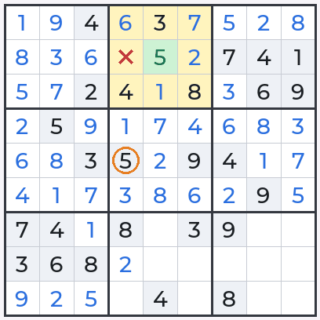

<!-- Written by tools/walkthrough.py non-consecutive: edit the script, not this page. -->
# Non-Consecutive, step 42: the 5 in box 2

**Step 42 of 55** · [← Step 41](step-41.md) · [All steps](../non-consecutive.md#the-whole-puzzle-step-by-step) · [Step 43 →](step-43.md)

Box 2 needs a 5. r2c4: column 4 has one (r5c4). Only **r2c5** is left: **r2c5 = 5**.

**Step 42 of 55** · [← Step 41](step-41.md) · [All steps](../non-consecutive.md#the-whole-puzzle-step-by-step) · [Step 43 →](step-43.md)
