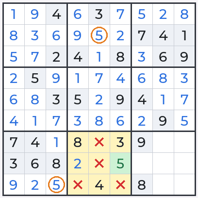

<!-- Written by tools/walkthrough.py non-consecutive: edit the script, not this page. -->
# Non-Consecutive, step 44: the 5 in box 8

**Step 44 of 55** · [← Step 43](step-43.md) · [All steps](../non-consecutive.md#the-whole-puzzle-step-by-step) · [Step 45 →](step-45.md)

Box 8 needs a 5. r7c5 and r8c5: column 5 has one (r2c5). r9c4 and r9c6: row 9 has one (r9c3). Only **r8c6** is left: **r8c6 = 5**.

**Step 44 of 55** · [← Step 43](step-43.md) · [All steps](../non-consecutive.md#the-whole-puzzle-step-by-step) · [Step 45 →](step-45.md)
