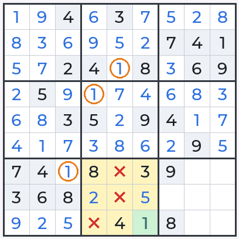

<!-- Written by tools/walkthrough.py non-consecutive: edit the script, not this page. -->
# Non-Consecutive, step 45: the 1 in box 8

**Step 45 of 55** · [← Step 44](step-44.md) · [All steps](../non-consecutive.md#the-whole-puzzle-step-by-step) · [Step 46 →](step-46.md)

Box 8 needs a 1. r7c5: row 7 has one (r7c3). r8c5: column 5 has one (r3c5). r9c4: column 4 has one (r4c4). Only **r9c6** is left: **r9c6 = 1**.

**Step 45 of 55** · [← Step 44](step-44.md) · [All steps](../non-consecutive.md#the-whole-puzzle-step-by-step) · [Step 46 →](step-46.md)
