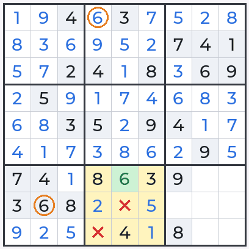

<!-- Written by tools/walkthrough.py non-consecutive: edit the script, not this page. -->
# Non-Consecutive, step 46: the 6 in box 8

**Step 46 of 55** · [← Step 45](step-45.md) · [All steps](../non-consecutive.md#the-whole-puzzle-step-by-step) · [Step 47 →](step-47.md)

Box 8 needs a 6. r8c5: row 8 has one (r8c2). r9c4: column 4 has one (r1c4). Only **r7c5** is left: **r7c5 = 6**.

**Step 46 of 55** · [← Step 45](step-45.md) · [All steps](../non-consecutive.md#the-whole-puzzle-step-by-step) · [Step 47 →](step-47.md)
