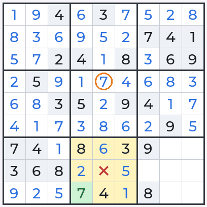

<!-- Written by tools/walkthrough.py non-consecutive: edit the script, not this page. -->
# Non-Consecutive, step 47: the 7 in box 8

**Step 47 of 55** · [← Step 46](step-46.md) · [All steps](../non-consecutive.md#the-whole-puzzle-step-by-step) · [Step 48 →](step-48.md)

Box 8 needs a 7. r8c5: column 5 has one (r4c5). Only **r9c4** is left: **r9c4 = 7**.

**Step 47 of 55** · [← Step 46](step-46.md) · [All steps](../non-consecutive.md#the-whole-puzzle-step-by-step) · [Step 48 →](step-48.md)
