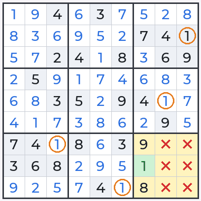

<!-- Written by tools/walkthrough.py non-consecutive: edit the script, not this page. -->
# Non-Consecutive, step 49: the 1 in box 9

**Step 49 of 55** · [← Step 48](step-48.md) · [All steps](../non-consecutive.md#the-whole-puzzle-step-by-step) · [Step 50 →](step-50.md)

Box 9 needs a 1. r7c8 and r7c9: row 7 has one (r7c3). r8c8: column 8 has one (r5c8). r8c9: column 9 has one (r2c9). r9c8 and r9c9: row 9 has one (r9c6). Only **r8c7** is left: **r8c7 = 1**.

**Step 49 of 55** · [← Step 48](step-48.md) · [All steps](../non-consecutive.md#the-whole-puzzle-step-by-step) · [Step 50 →](step-50.md)
