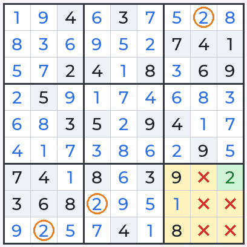

<!-- Written by tools/walkthrough.py non-consecutive: edit the script, not this page. -->
# Non-Consecutive, step 50: the 2 in box 9

**Step 50 of 55** · [← Step 49](step-49.md) · [All steps](../non-consecutive.md#the-whole-puzzle-step-by-step) · [Step 51 →](step-51.md)

Box 9 needs a 2. r7c8: column 8 has one (r1c8). r8c8 and r8c9: row 8 has one (r8c4). r9c8 and r9c9: row 9 has one (r9c2). Only **r7c9** is left: **r7c9 = 2**.

**Step 50 of 55** · [← Step 49](step-49.md) · [All steps](../non-consecutive.md#the-whole-puzzle-step-by-step) · [Step 51 →](step-51.md)
