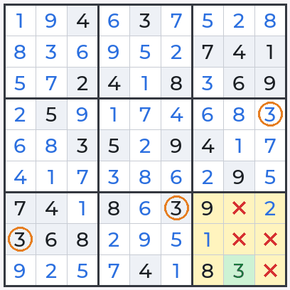

<!-- Written by tools/walkthrough.py non-consecutive: edit the script, not this page. -->
# Non-Consecutive, step 51: the 3 in box 9

**Step 51 of 55** · [← Step 50](step-50.md) · [All steps](../non-consecutive.md#the-whole-puzzle-step-by-step) · [Step 52 →](step-52.md)

Box 9 needs a 3. r7c8: row 7 has one (r7c6). r8c8 and r8c9: row 8 has one (r8c1). r9c9: column 9 has one (r4c9). Only **r9c8** is left: **r9c8 = 3**.

**Step 51 of 55** · [← Step 50](step-50.md) · [All steps](../non-consecutive.md#the-whole-puzzle-step-by-step) · [Step 52 →](step-52.md)
