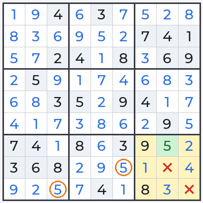

<!-- Written by tools/walkthrough.py non-consecutive: edit the script, not this page. -->
# Non-Consecutive, step 53: the 5 in box 9

**Step 53 of 55** · [← Step 52](step-52.md) · [All steps](../non-consecutive.md#the-whole-puzzle-step-by-step) · [Step 54 →](step-54.md)

Box 9 needs a 5. r8c8: row 8 has one (r8c6). r9c9: row 9 has one (r9c3). Only **r7c8** is left: **r7c8 = 5**.

**Step 53 of 55** · [← Step 52](step-52.md) · [All steps](../non-consecutive.md#the-whole-puzzle-step-by-step) · [Step 54 →](step-54.md)
