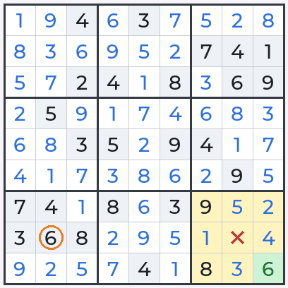

<!-- Written by tools/walkthrough.py non-consecutive: edit the script, not this page. -->
# Non-Consecutive, step 54: the 6 in box 9

**Step 54 of 55** · [← Step 53](step-53.md) · [All steps](../non-consecutive.md#the-whole-puzzle-step-by-step) · [Step 55 →](step-55.md)

Box 9 needs a 6. r8c8: row 8 has one (r8c2). Only **r9c9** is left: **r9c9 = 6**.

**Step 54 of 55** · [← Step 53](step-53.md) · [All steps](../non-consecutive.md#the-whole-puzzle-step-by-step) · [Step 55 →](step-55.md)
