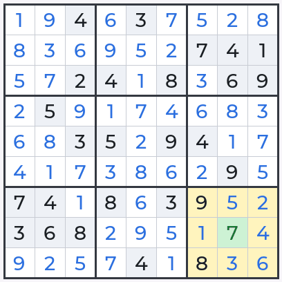

<!-- Written by tools/walkthrough.py non-consecutive: edit the script, not this page. -->
# Non-Consecutive, step 55: the 7 in box 9

**Step 55 of 55** · [← Step 54](step-54.md) · [All steps](../non-consecutive.md#the-whole-puzzle-step-by-step) · [All steps](../non-consecutive.md#the-whole-puzzle-step-by-step)

Box 9 needs a 7, and r8c8 is its last empty cell: **r8c8 = 7**.

Solved.

**Step 55 of 55** · [← Step 54](step-54.md) · [All steps](../non-consecutive.md#the-whole-puzzle-step-by-step) · [All steps](../non-consecutive.md#the-whole-puzzle-step-by-step)
