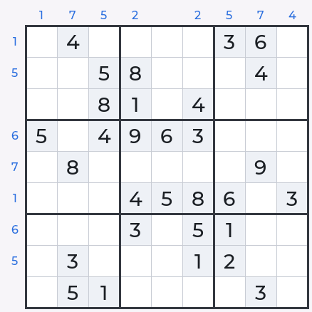

# Numbered Rooms

[← All variants](README.md) · [Puzzles](../features-puzzles.md) · [How to play](../how-to-play.md)

## The rules

[Classic](classic.md) rules, and **clues** left of some rows and above some columns. Read the row from the left (the column from the top): its **first digit is X**, and the clue is **the digit in the X-th cell**. In 3, 7, 5, 9, 4 the first digit is 3, so the clue is the third digit: 5. A line without a clue has no such rule.

## On the board

- The clues are in blue in a margin left of the rows and above the columns; a line without a clue has none.
- Once a line's first digit is in, it and the cell it points at turn red if that cell holds another digit.
- The grader and hints try each first digit a clue still allows: "The clue of row 5 is 7: the first digit from there, X, says the X-th cell holds it ...".
- **Puzzles → ⋮ → New puzzle → Clues → Numbered Rooms**: about three quarters of the lines have a clue (Hard and Expert: about 60 %).

## How to solve it

- **A clue of 1 can mean the line starts with 1** (the first cell points at itself). Any other clue: the line **doesn't** start with 1, and doesn't start with the clue itself (the first cell holds X, the X-th cell the clue, and they're different cells).
- **Each first digit X points at one cell:** the clue must be able to go there. Where the clue is already placed on the line, X is the place it's in.
- **Once the first digit is known**, the clue is fixed in its cell, and no other cell of the line can hold it.

## Worked example

**variant-examples #44**, Numbered Rooms Easy (see [Classic](classic.md#worked-example-the-whole-puzzle) for how to import the examples; cells are written r*row*c*column*). The clues are in the picture; from the left, row 5's is **7**; from the top, column 8's is **7**.

**Step 1: r5c4, row 5 (clue 7).** Column 4 has 1, 3 and 4; box 5 has 5 and 6; row 5 has 8 and 9: that leaves 2 and 7. With the 7 in r5c4, the fourth cell of row 5, the row would have to start with 4. But box 4 already has a 4 (r4c3), so r5c1 can't be 4. **r5c4 = 2**.

**Step 2: r7c8, column 8 (clue 7).** Row 7 has 1, 3 and 5; box 9 has 2; column 8 has 4, 6 and 9: that leaves 7 and 8. Column 8 starts with the 6 in r1c8, so its clue 7 is in its sixth cell, r6c8, and no other cell of the column can be 7. **r7c8 = 8**.

**Step 3: r8c8, column 8 again.** Row 8 has 1, 2 and 3; column 8 has 4, 6, 8 and 9: that leaves 5 and 7. The 7 belongs in r6c8, as in step 2. **r8c8 = 5**.

## The whole puzzle, step by step

<!-- walkthrough -->
<!-- Written by tools/walkthrough.py numbered-rooms: edit the script, not this part. -->

The whole puzzle, from the start to the last cell: 51 steps, each one a single (one place left for a digit, or one digit left for a cell), taken in the order a box's single comes first, so not quite the order of the worked example above. Each step has a page of its own, with **Previous** and **Next**: pick its number below. In each picture, the unit the step looks at is tinted yellow (for a cell with one digit left: its row, column and box), the new digit is on green, the digits that rule cells out have an **orange ring**, and the empty cells they rule out a **red cross**. Givens are on grey, digits from earlier steps in blue.

| [1](numbered-rooms/step-01.md) | [2](numbered-rooms/step-02.md) | [3](numbered-rooms/step-03.md) | [4](numbered-rooms/step-04.md) | [5](numbered-rooms/step-05.md) | [6](numbered-rooms/step-06.md) | [7](numbered-rooms/step-07.md) | [8](numbered-rooms/step-08.md) | [9](numbered-rooms/step-09.md) | [10](numbered-rooms/step-10.md) |
|:-:|:-:|:-:|:-:|:-:|:-:|:-:|:-:|:-:|:-:|
| [11](numbered-rooms/step-11.md) | [12](numbered-rooms/step-12.md) | [13](numbered-rooms/step-13.md) | [14](numbered-rooms/step-14.md) | [15](numbered-rooms/step-15.md) | [16](numbered-rooms/step-16.md) | [17](numbered-rooms/step-17.md) | [18](numbered-rooms/step-18.md) | [19](numbered-rooms/step-19.md) | [20](numbered-rooms/step-20.md) |
| [21](numbered-rooms/step-21.md) | [22](numbered-rooms/step-22.md) | [23](numbered-rooms/step-23.md) | [24](numbered-rooms/step-24.md) | [25](numbered-rooms/step-25.md) | [26](numbered-rooms/step-26.md) | [27](numbered-rooms/step-27.md) | [28](numbered-rooms/step-28.md) | [29](numbered-rooms/step-29.md) | [30](numbered-rooms/step-30.md) |
| [31](numbered-rooms/step-31.md) | [32](numbered-rooms/step-32.md) | [33](numbered-rooms/step-33.md) | [34](numbered-rooms/step-34.md) | [35](numbered-rooms/step-35.md) | [36](numbered-rooms/step-36.md) | [37](numbered-rooms/step-37.md) | [38](numbered-rooms/step-38.md) | [39](numbered-rooms/step-39.md) | [40](numbered-rooms/step-40.md) |
| [41](numbered-rooms/step-41.md) | [42](numbered-rooms/step-42.md) | [43](numbered-rooms/step-43.md) | [44](numbered-rooms/step-44.md) | [45](numbered-rooms/step-45.md) | [46](numbered-rooms/step-46.md) | [47](numbered-rooms/step-47.md) | [48](numbered-rooms/step-48.md) | [49](numbered-rooms/step-49.md) | [50](numbered-rooms/step-50.md) |
| [51](numbered-rooms/step-51.md) |  |  |  |  |  |  |  |  |  |

Solved.

<!-- /walkthrough -->
