# Numbered Rooms

[← All variants](README.md) · [Puzzles](../features-puzzles.md) · [How to play](../how-to-play.md)

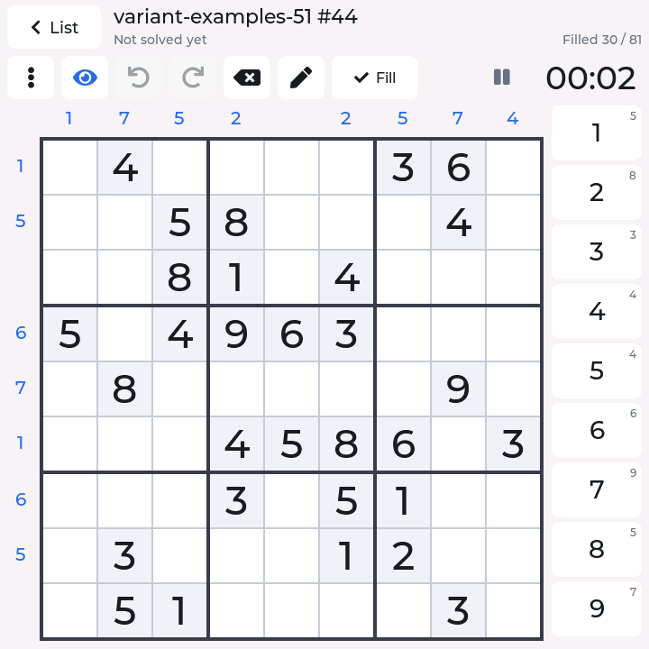

## The rules

[Classic](classic.md) rules, and **clues** left of some rows and above some columns. Read the row from the left (the column from the top): its **first digit is X**, and the clue is **the digit in the X-th cell**. In 3, 7, 5, 9, 4 the first digit is 3, so the clue is the third digit: 5. A line without a clue has no such rule.

## On the board

- The clues are in blue in a margin left of the rows and above the columns; a line without a clue has none.
- Once a line's first digit is in, it and the cell it points at turn red if that cell holds another digit.
- The grader and hints try each first digit a clue still allows: "The clue of row 5 is 7: the first digit from there, X, says the X-th cell holds it ...".
- **Puzzles → ⋮ → New puzzle → Clues → Numbered Rooms**: about three quarters of the lines have a clue (Hard and Expert: about 60 %).

## How to solve it

- **A clue of 1 can mean the line starts with 1** (the first cell points at itself). Any other clue: the line **doesn't** start with 1, and doesn't start with the clue itself (the first cell holds X, the X-th cell the clue, and they're different cells).
- **Each first digit X points at one cell:** the clue must be able to go there. Where the clue is already placed on the line, X is the place it's in.
- **Once the first digit is known**, the clue is fixed in its cell, and no other cell of the line can hold it.

## Worked example

**variant-examples #44**, Numbered Rooms Easy (see [Classic](classic.md#worked-example-the-whole-puzzle) for how to import the examples; cells are written r*row*c*column*). The clues are in the picture; from the left, row 5's is **7**; from the top, column 8's is **7**.

**Step 1: r5c4, row 5 (clue 7).** Column 4 has 1, 3 and 4; box 5 has 5 and 6; row 5 has 8 and 9: that leaves 2 and 7. With the 7 in r5c4, the fourth cell of row 5, the row would have to start with 4. But box 4 already has a 4 (r4c3), so r5c1 can't be 4. **r5c4 = 2**.

**Step 2: r7c8, column 8 (clue 7).** Row 7 has 1, 3 and 5; box 9 has 2; column 8 has 4, 6 and 9: that leaves 7 and 8. Column 8 starts with the 6 in r1c8, so its clue 7 is in its sixth cell, r6c8, and no other cell of the column can be 7. **r7c8 = 8**.

**Step 3: r8c8, column 8 again.** Row 8 has 1, 2 and 3; column 8 has 4, 6, 8 and 9: that leaves 5 and 7. The 7 belongs in r6c8, as in step 2. **r8c8 = 5**.

## The whole puzzle, step by step

<!-- walkthrough -->
<!-- Written by tools/walkthrough.py numbered-rooms: edit the script, not this part. -->

The whole puzzle, from the start to the last cell: 51 steps, each one a single (one place left for a digit, or one digit left for a cell), taken in the order a box's single comes first, so not quite the order of the worked example above. In each picture, the unit the step looks at is tinted yellow (for a cell with one digit left: its row, column and box), the new digit is on green, the digits that rule cells out have an **orange ring**, and the empty cells they rule out a **red cross**. Givens are on grey, digits from earlier steps in blue.

#### Step 1: the 7 in box 1

Box 1 needs a 7. r1c1: with a 7 first, the seventh cell of row 1 would have to hold its clue 1, but it's 3. r1c3: with a 7 first, the seventh cell of column 3 (r7c3) would have to hold its clue 5, which can't go there. r2c1: with a 7 first, the seventh cell of row 2 (r2c7) would have to hold its clue 5, which can't go there. r2c2 and r3c2: Column 2 starts with a 4, so its clue 7 is in its fourth cell, not here. Only **r3c1** is left: **r3c1 = 7**.

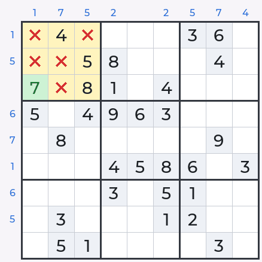

#### Step 2: the 3 in box 1

Box 1 needs a 3. r1c1 and r1c3: row 1 has one (r1c7). r2c2 and r3c2: column 2 has one (r8c2). Only **r2c1** is left: **r2c1 = 3**.

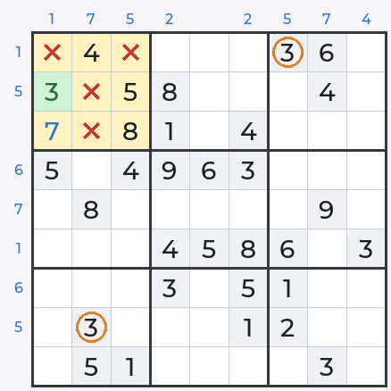

#### Step 3: the 3 in box 2

Box 2 needs a 3. r1c4, r1c5 and r1c6: row 1 has one (r1c7). r2c5 and r2c6: row 2 has one (r2c1). Only **r3c5** is left: **r3c5 = 3**.

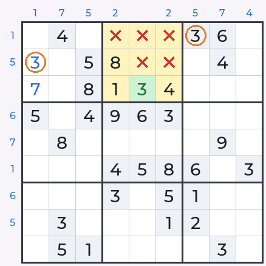

#### Step 4: the 5 in box 2

Box 2 needs a 5. r1c5: column 5 has one (r6c5). r1c6: column 6 has one (r7c6). r2c5 and r2c6: row 2 has one (r2c3). Only **r1c4** is left: **r1c4 = 5**.

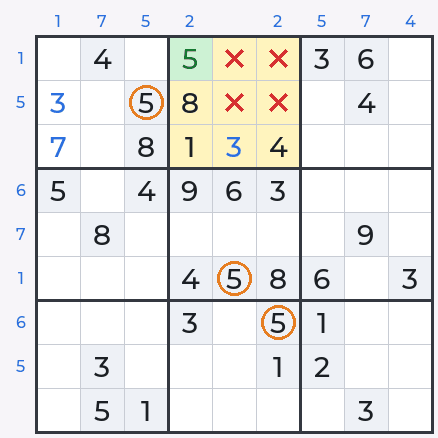

#### Step 5: the 6 in box 2

Box 2 needs a 6. r1c5 and r1c6: row 1 has one (r1c8). r2c5: column 5 has one (r4c5). Only **r2c6** is left: **r2c6 = 6**.

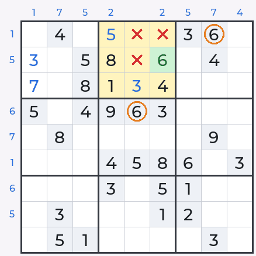

#### Step 6: the 6 in box 1

Box 1 needs a 6. r1c1 and r1c3: row 1 has one (r1c8). r2c2: row 2 has one (r2c6). Only **r3c2** is left: **r3c2 = 6**.

#### Step 7: the 1 in box 3

Box 3 needs a 1. r2c7: column 7 has one (r7c7). r3c7, r3c8 and r3c9: row 3 has one (r3c4). r1c9: it's the first cell after a clue of 4: a 1 there would make the clue itself 1. Only **r2c9** is left: **r2c9 = 1**.

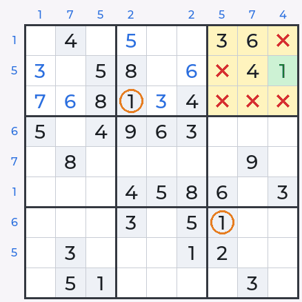

#### Step 8: the 1 in box 1

Box 1 needs a 1. r1c3: column 3 has one (r9c3). r2c2: row 2 has one (r2c9). Only **r1c1** is left: **r1c1 = 1**.

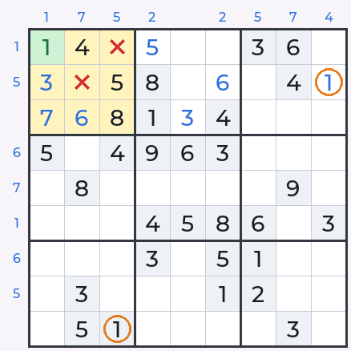

#### Step 9: the 9 in box 1

Box 1 needs a 9. r1c3: with a 9 first, the ninth cell of column 3 would have to hold its clue 5, but it's 1. Only **r2c2** is left: **r2c2 = 9**.

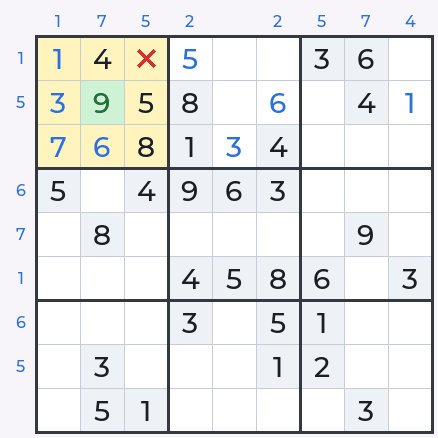

#### Step 10: the 2 in box 1

Box 1 needs a 2, and r1c3 is its last empty cell: **r1c3 = 2**.

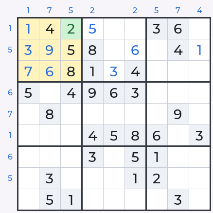

#### Step 11: the 2 in box 2

Box 2 needs a 2. r1c5 and r1c6: row 1 has one (r1c3). Only **r2c5** is left: **r2c5 = 2**.

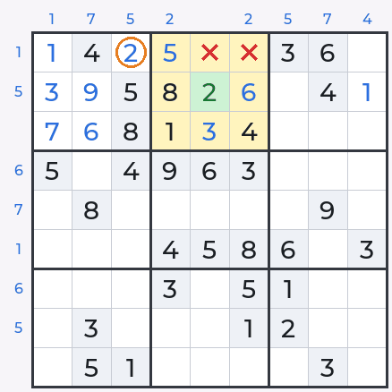

#### Step 12: the 7 in box 2

Box 2 needs a 7. r1c6: with a 7 first, the seventh cell of column 6 would have to hold its clue 2, but it's 5. Only **r1c5** is left: **r1c5 = 7**.

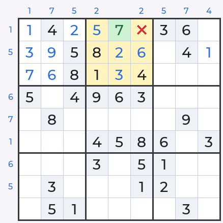

#### Step 13: the 9 in box 2

Box 2 needs a 9, and r1c6 is its last empty cell: **r1c6 = 9**.

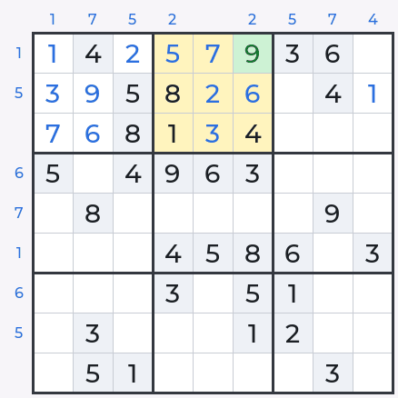

#### Step 14: the 7 in box 3

Box 3 needs a 7. r1c9: row 1 has one (r1c5). r3c7, r3c8 and r3c9: row 3 has one (r3c1). Only **r2c7** is left: **r2c7 = 7**.

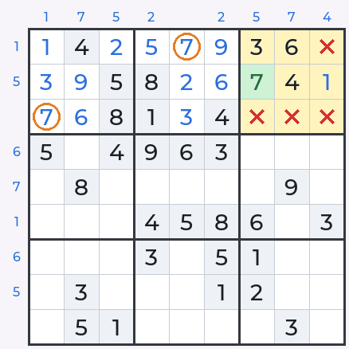

#### Step 15: the 8 in box 3

Box 3 needs an 8. r3c7, r3c8 and r3c9: row 3 has one (r3c3). Only **r1c9** is left: **r1c9 = 8**.

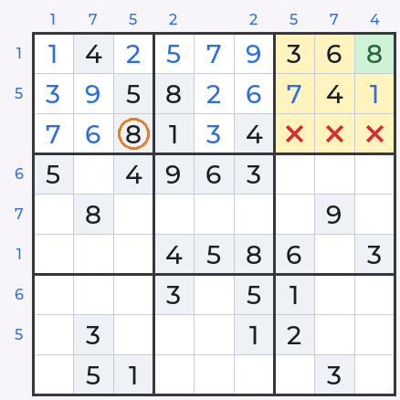

#### Step 16: the 9 in box 3

Box 3 needs a 9. r3c8: column 8 has one (r5c8). r3c7: Column 7 starts with a 3, so its third cell is its clue 5. Only **r3c9** is left: **r3c9 = 9**.

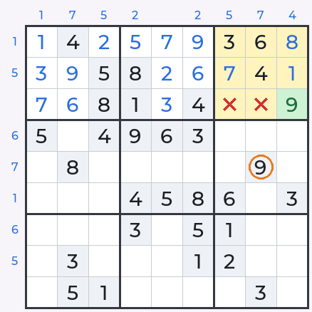

#### Step 17: the 2 in box 3

Box 3 needs a 2. r3c7: column 7 has one (r8c7). Only **r3c8** is left: **r3c8 = 2**.

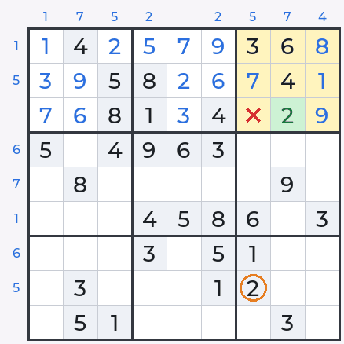

#### Step 18: the 5 in box 3

Box 3 needs a 5, and r3c7 is its last empty cell: **r3c7 = 5**.

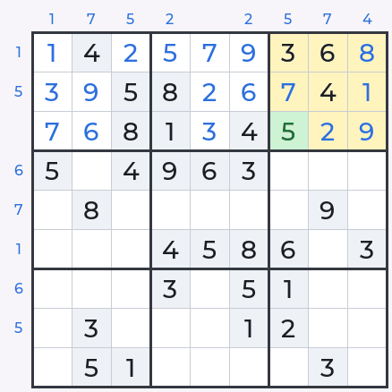

#### Step 19: the 1 in box 4

Box 4 needs a 1. r5c1 and r6c1: column 1 has one (r1c1). r5c3 and r6c3: column 3 has one (r9c3). r4c2: Column 2 starts with a 4, so its fourth cell is its clue 7. Only **r6c2** is left: **r6c2 = 1**.

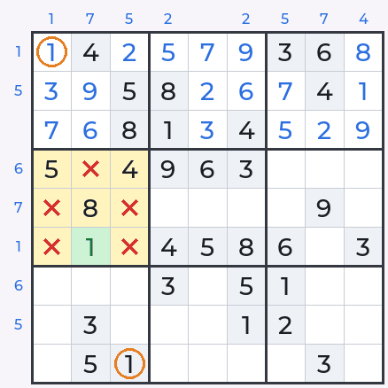

#### Step 20: the 2 in box 4

Box 4 needs a 2. r5c3 and r6c3: column 3 has one (r1c3). r4c2: Column 2 starts with a 4, so its fourth cell is its clue 7. r5c1: with a 2 first, the second cell of row 5 would have to hold its clue 7, but it's 8. Only **r6c1** is left: **r6c1 = 2**.

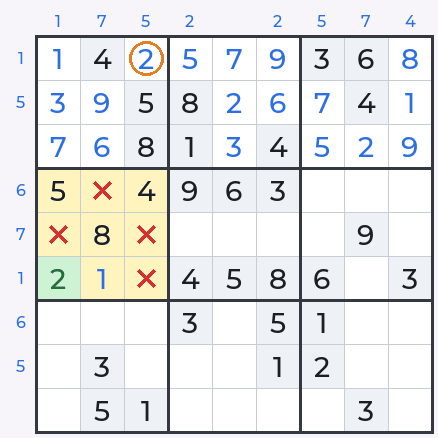

#### Step 21: the 3 in box 4

Box 4 needs a 3. r4c2: row 4 has one (r4c6). r5c1: column 1 has one (r2c1). r6c3: row 6 has one (r6c9). Only **r5c3** is left: **r5c3 = 3**.

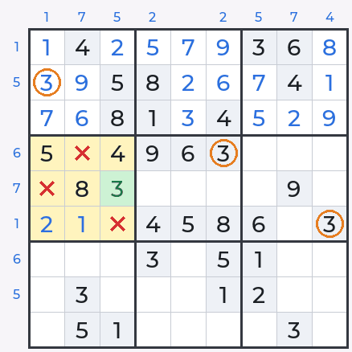

#### Step 22: the 6 in box 4

Box 4 needs a 6. r4c2: row 4 has one (r4c5). r6c3: row 6 has one (r6c7). Only **r5c1** is left: **r5c1 = 6**.

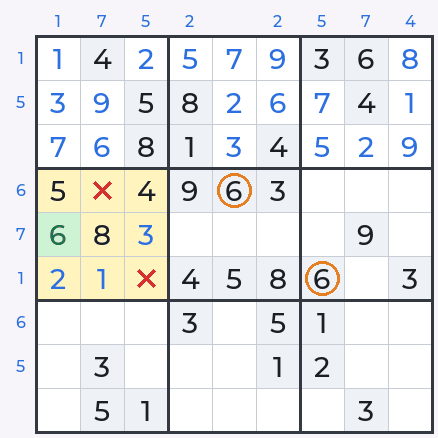

#### Step 23: the 9 in box 4

Box 4 needs a 9. r4c2: row 4 has one (r4c4). Only **r6c3** is left: **r6c3 = 9**.

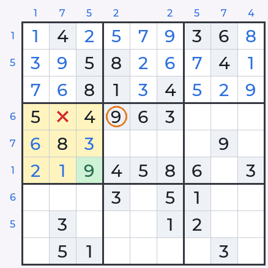

#### Step 24: the 7 in box 4

Box 4 needs a 7, and r4c2 is its last empty cell: **r4c2 = 7**.

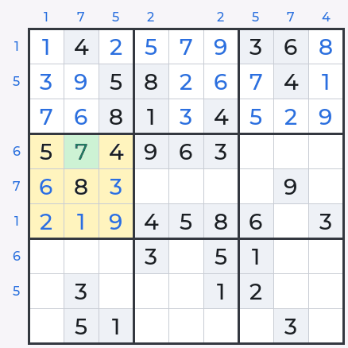

#### Step 25: the 1 in box 5

Box 5 needs a 1. r5c4: column 4 has one (r3c4). r5c6: column 6 has one (r8c6). Only **r5c5** is left: **r5c5 = 1**.

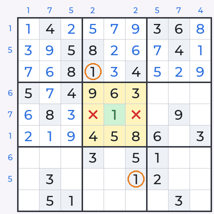

#### Step 26: the 2 in box 5

Box 5 needs a 2. r5c6: Row 5 starts with a 6, so its sixth cell is its clue 7. Only **r5c4** is left: **r5c4 = 2**.

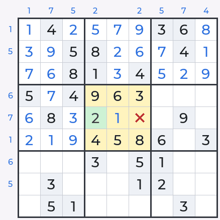

#### Step 27: the 7 in box 5

Box 5 needs a 7, and r5c6 is its last empty cell: **r5c6 = 7**.

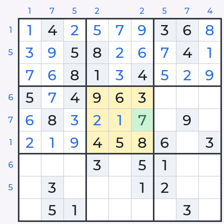

#### Step 28: the 1 in box 6

Box 6 needs a 1. r4c7: column 7 has one (r7c7). r4c9: column 9 has one (r2c9). r5c7 and r5c9: row 5 has one (r5c5). r6c8: row 6 has one (r6c2). Only **r4c8** is left: **r4c8 = 1**.

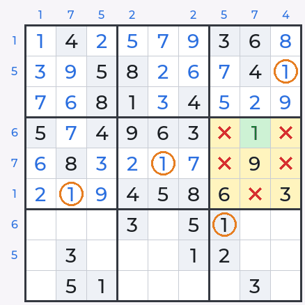

#### Step 29: the 2 in box 6

Box 6 needs a 2. r4c7: column 7 has one (r8c7). r5c7 and r5c9: row 5 has one (r5c4). r6c8: row 6 has one (r6c1). Only **r4c9** is left: **r4c9 = 2**.

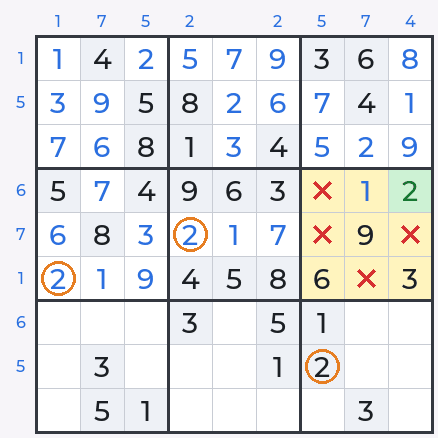

#### Step 30: the 4 in box 6

Box 6 needs a 4. r4c7: row 4 has one (r4c3). r6c8: row 6 has one (r6c4). r5c9: Column 9 starts with an 8, so its clue 4 is in its eighth cell, not here. Only **r5c7** is left: **r5c7 = 4**.

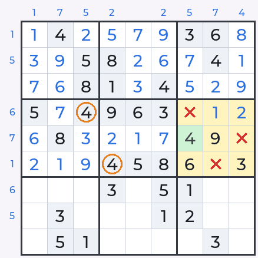

#### Step 31: the 5 in box 6

Box 6 needs a 5. r4c7: row 4 has one (r4c1). r6c8: row 6 has one (r6c5). Only **r5c9** is left: **r5c9 = 5**.

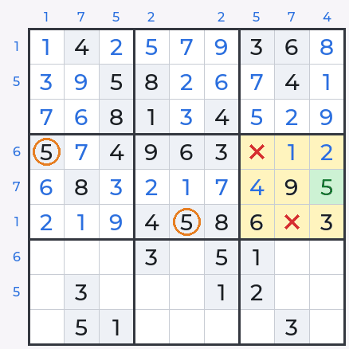

#### Step 32: the 7 in box 6

Box 6 needs a 7. r4c7: row 4 has one (r4c2). Only **r6c8** is left: **r6c8 = 7**.

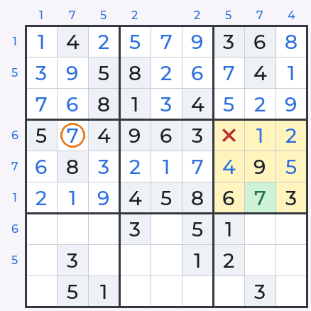

#### Step 33: the 8 in box 6

Box 6 needs an 8, and r4c7 is its last empty cell: **r4c7 = 8**.

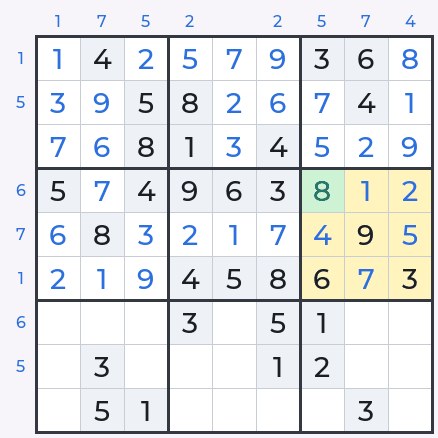

#### Step 34: the 2 in box 7

Box 7 needs a 2. r7c1 and r9c1: column 1 has one (r6c1). r7c3: column 3 has one (r1c3). r8c1 and r8c3: row 8 has one (r8c7). Only **r7c2** is left: **r7c2 = 2**.

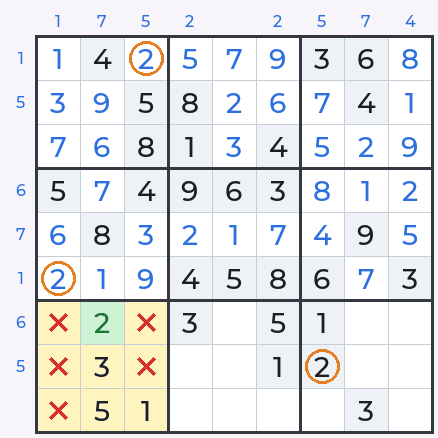

#### Step 35: the 6 in box 7

Box 7 needs a 6. r7c1, r8c1 and r9c1: column 1 has one (r5c1). r7c3: with a 6 here, no first digit of row 7 could point at a cell holding its clue 6. Only **r8c3** is left: **r8c3 = 6**.

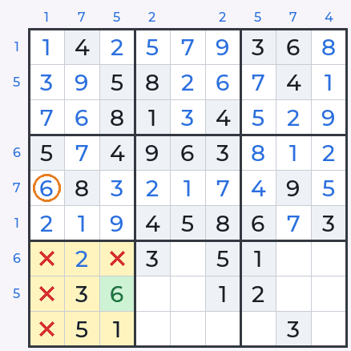

#### Step 36: the 7 in box 7

Box 7 needs a 7. r7c1, r8c1 and r9c1: column 1 has one (r3c1). Only **r7c3** is left: **r7c3 = 7**.

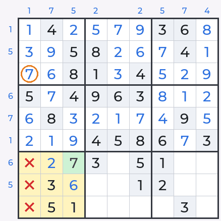

#### Step 37: the 2 in box 8

Box 8 needs a 2. r7c5: row 7 has one (r7c2). r8c4 and r8c5: row 8 has one (r8c7). r9c4: column 4 has one (r5c4). r9c5: column 5 has one (r2c5). Only **r9c6** is left: **r9c6 = 2**.

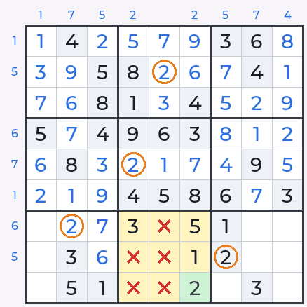

#### Step 38: the 6 in box 8

Box 8 needs a 6. r7c5 and r9c5: column 5 has one (r4c5). r8c4 and r8c5: row 8 has one (r8c3). Only **r9c4** is left: **r9c4 = 6**.

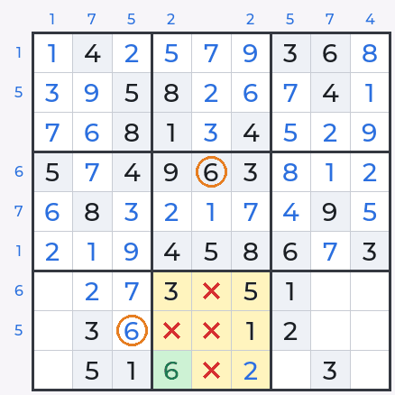

#### Step 39: the 7 in box 8

Box 8 needs a 7. r7c5: row 7 has one (r7c3). r8c5 and r9c5: column 5 has one (r1c5). Only **r8c4** is left: **r8c4 = 7**.

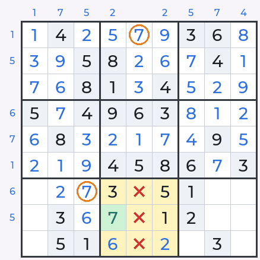

#### Step 40: the 4 in box 7

Box 7 needs a 4. r7c1: with a 4 first, the fourth cell of row 7 would have to hold its clue 6, but it's 3. r8c1: with a 4 first, the fourth cell of row 8 would have to hold its clue 5, but it's 7. Only **r9c1** is left: **r9c1 = 4**.

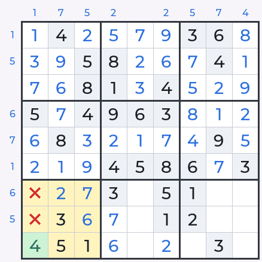

#### Step 41: the 4 in box 9

Box 9 needs a 4. r7c8 and r8c8: column 8 has one (r2c8). r9c7 and r9c9: row 9 has one (r9c1). r7c9: Column 9 starts with an 8, so its clue 4 is in its eighth cell, not here. Only **r8c9** is left: **r8c9 = 4**.

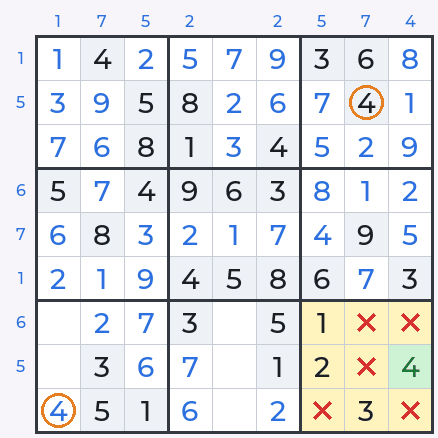

#### Step 42: the 9 in box 7

Box 7 needs a 9. r8c1: with a 9 first, the ninth cell of row 8 would have to hold its clue 5, but it's 4. Only **r7c1** is left: **r7c1 = 9**.

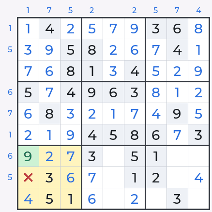

#### Step 43: the 8 in box 7

Box 7 needs an 8, and r8c1 is its last empty cell: **r8c1 = 8**.

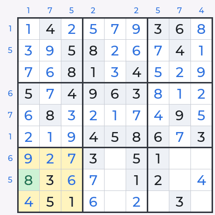

#### Step 44: the 4 in box 8

Box 8 needs a 4. r8c5: row 8 has one (r8c9). r9c5: row 9 has one (r9c1). Only **r7c5** is left: **r7c5 = 4**.

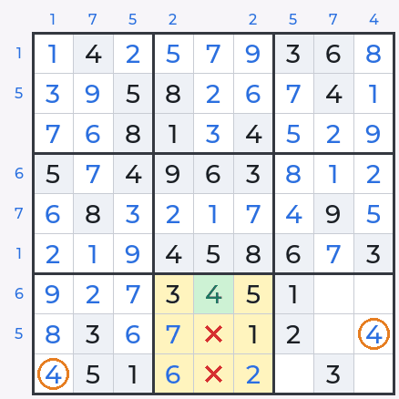

#### Step 45: the 8 in box 8

Box 8 needs an 8. r8c5: row 8 has one (r8c1). Only **r9c5** is left: **r9c5 = 8**.

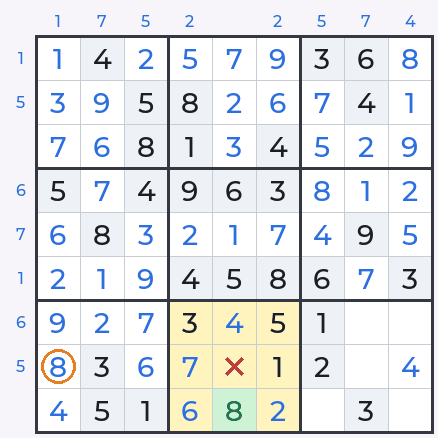

#### Step 46: the 9 in box 8

Box 8 needs a 9, and r8c5 is its last empty cell: **r8c5 = 9**.

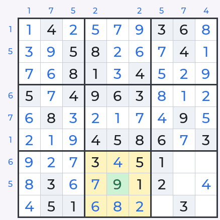

#### Step 47: the 5 in box 9

Box 9 needs a 5. r7c8 and r7c9: row 7 has one (r7c6). r9c7 and r9c9: row 9 has one (r9c2). Only **r8c8** is left: **r8c8 = 5**.

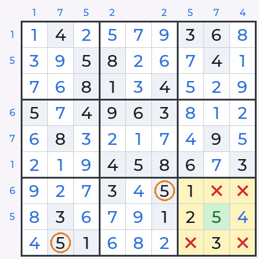

#### Step 48: the 6 in box 9

Box 9 needs a 6. r7c8: column 8 has one (r1c8). r9c7 and r9c9: row 9 has one (r9c4). Only **r7c9** is left: **r7c9 = 6**.

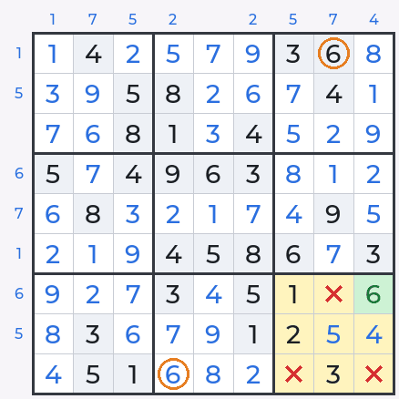

#### Step 49: the 7 in box 9

Box 9 needs a 7. r7c8: row 7 has one (r7c3). r9c7: column 7 has one (r2c7). Only **r9c9** is left: **r9c9 = 7**.

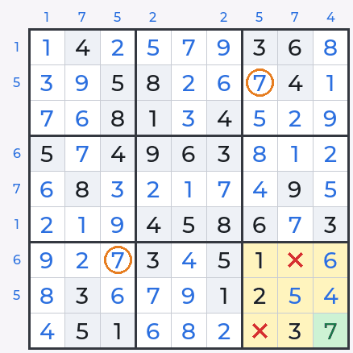

#### Step 50: the 8 in box 9

Box 9 needs an 8. r9c7: row 9 has one (r9c5). Only **r7c8** is left: **r7c8 = 8**.

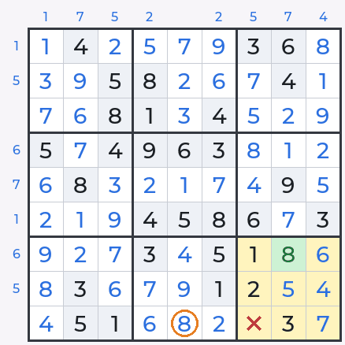

#### Step 51: the 9 in box 9

Box 9 needs a 9, and r9c7 is its last empty cell: **r9c7 = 9**.

Solved.

<!-- /walkthrough -->
