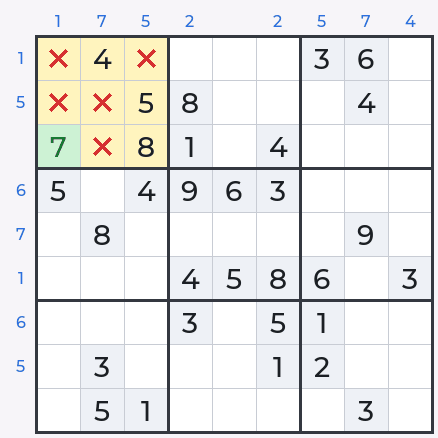

<!-- Written by tools/walkthrough.py numbered-rooms: edit the script, not this page. -->
# Numbered Rooms, step 1: the 7 in box 1

**Step 1 of 51** · [← The start](../numbered-rooms.md#the-whole-puzzle-step-by-step) · [All steps](../numbered-rooms.md#the-whole-puzzle-step-by-step) · [Step 2 →](step-02.md)

Box 1 needs a 7. r1c1: with a 7 first, the seventh cell of row 1 would have to hold its clue 1, but it's 3. r1c3: with a 7 first, the seventh cell of column 3 (r7c3) would have to hold its clue 5, which can't go there. r2c1: with a 7 first, the seventh cell of row 2 (r2c7) would have to hold its clue 5, which can't go there. r2c2 and r3c2: Column 2 starts with a 4, so its clue 7 is in its fourth cell, not here. Only **r3c1** is left: **r3c1 = 7**.

**Step 1 of 51** · [← The start](../numbered-rooms.md#the-whole-puzzle-step-by-step) · [All steps](../numbered-rooms.md#the-whole-puzzle-step-by-step) · [Step 2 →](step-02.md)
