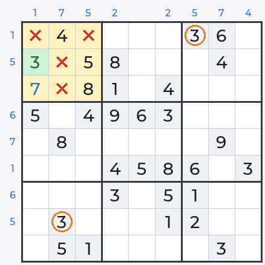

<!-- Written by tools/walkthrough.py numbered-rooms: edit the script, not this page. -->
# Numbered Rooms, step 2: the 3 in box 1

**Step 2 of 51** · [← Step 1](step-01.md) · [All steps](../numbered-rooms.md#the-whole-puzzle-step-by-step) · [Step 3 →](step-03.md)

Box 1 needs a 3. r1c1 and r1c3: row 1 has one (r1c7). r2c2 and r3c2: column 2 has one (r8c2). Only **r2c1** is left: **r2c1 = 3**.

**Step 2 of 51** · [← Step 1](step-01.md) · [All steps](../numbered-rooms.md#the-whole-puzzle-step-by-step) · [Step 3 →](step-03.md)
