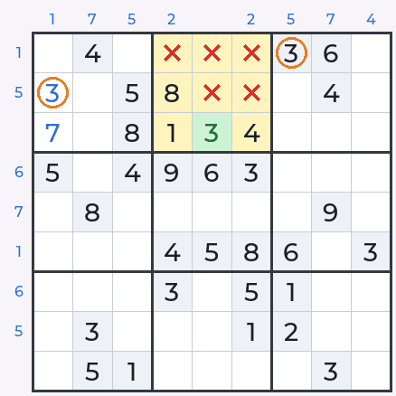

<!-- Written by tools/walkthrough.py numbered-rooms: edit the script, not this page. -->
# Numbered Rooms, step 3: the 3 in box 2

**Step 3 of 51** · [← Step 2](step-02.md) · [All steps](../numbered-rooms.md#the-whole-puzzle-step-by-step) · [Step 4 →](step-04.md)

Box 2 needs a 3. r1c4, r1c5 and r1c6: row 1 has one (r1c7). r2c5 and r2c6: row 2 has one (r2c1). Only **r3c5** is left: **r3c5 = 3**.

**Step 3 of 51** · [← Step 2](step-02.md) · [All steps](../numbered-rooms.md#the-whole-puzzle-step-by-step) · [Step 4 →](step-04.md)
