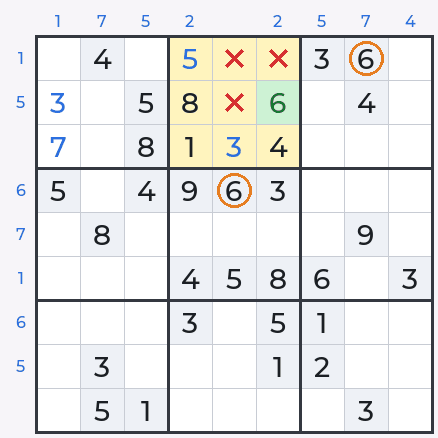

<!-- Written by tools/walkthrough.py numbered-rooms: edit the script, not this page. -->
# Numbered Rooms, step 5: the 6 in box 2

**Step 5 of 51** · [← Step 4](step-04.md) · [All steps](../numbered-rooms.md#the-whole-puzzle-step-by-step) · [Step 6 →](step-06.md)

Box 2 needs a 6. r1c5 and r1c6: row 1 has one (r1c8). r2c5: column 5 has one (r4c5). Only **r2c6** is left: **r2c6 = 6**.

**Step 5 of 51** · [← Step 4](step-04.md) · [All steps](../numbered-rooms.md#the-whole-puzzle-step-by-step) · [Step 6 →](step-06.md)
