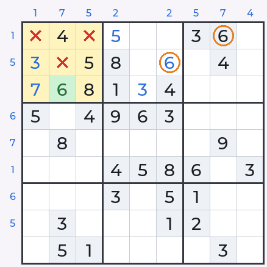

<!-- Written by tools/walkthrough.py numbered-rooms: edit the script, not this page. -->
# Numbered Rooms, step 6: the 6 in box 1

**Step 6 of 51** · [← Step 5](step-05.md) · [All steps](../numbered-rooms.md#the-whole-puzzle-step-by-step) · [Step 7 →](step-07.md)

Box 1 needs a 6. r1c1 and r1c3: row 1 has one (r1c8). r2c2: row 2 has one (r2c6). Only **r3c2** is left: **r3c2 = 6**.

**Step 6 of 51** · [← Step 5](step-05.md) · [All steps](../numbered-rooms.md#the-whole-puzzle-step-by-step) · [Step 7 →](step-07.md)
