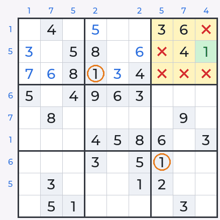

<!-- Written by tools/walkthrough.py numbered-rooms: edit the script, not this page. -->
# Numbered Rooms, step 7: the 1 in box 3

**Step 7 of 51** · [← Step 6](step-06.md) · [All steps](../numbered-rooms.md#the-whole-puzzle-step-by-step) · [Step 8 →](step-08.md)

Box 3 needs a 1. r2c7: column 7 has one (r7c7). r3c7, r3c8 and r3c9: row 3 has one (r3c4). r1c9: it's the first cell after a clue of 4: a 1 there would make the clue itself 1. Only **r2c9** is left: **r2c9 = 1**.

**Step 7 of 51** · [← Step 6](step-06.md) · [All steps](../numbered-rooms.md#the-whole-puzzle-step-by-step) · [Step 8 →](step-08.md)
