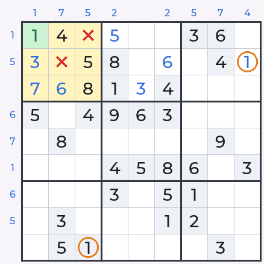

<!-- Written by tools/walkthrough.py numbered-rooms: edit the script, not this page. -->
# Numbered Rooms, step 8: the 1 in box 1

**Step 8 of 51** · [← Step 7](step-07.md) · [All steps](../numbered-rooms.md#the-whole-puzzle-step-by-step) · [Step 9 →](step-09.md)

Box 1 needs a 1. r1c3: column 3 has one (r9c3). r2c2: row 2 has one (r2c9). Only **r1c1** is left: **r1c1 = 1**.

**Step 8 of 51** · [← Step 7](step-07.md) · [All steps](../numbered-rooms.md#the-whole-puzzle-step-by-step) · [Step 9 →](step-09.md)
