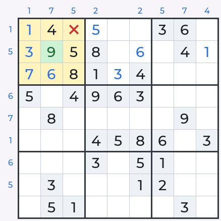

<!-- Written by tools/walkthrough.py numbered-rooms: edit the script, not this page. -->
# Numbered Rooms, step 9: the 9 in box 1

**Step 9 of 51** · [← Step 8](step-08.md) · [All steps](../numbered-rooms.md#the-whole-puzzle-step-by-step) · [Step 10 →](step-10.md)

Box 1 needs a 9. r1c3: with a 9 first, the ninth cell of column 3 would have to hold its clue 5, but it's 1. Only **r2c2** is left: **r2c2 = 9**.

**Step 9 of 51** · [← Step 8](step-08.md) · [All steps](../numbered-rooms.md#the-whole-puzzle-step-by-step) · [Step 10 →](step-10.md)
