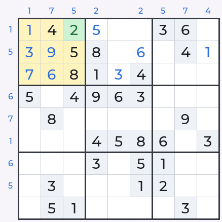

<!-- Written by tools/walkthrough.py numbered-rooms: edit the script, not this page. -->
# Numbered Rooms, step 10: the 2 in box 1

**Step 10 of 51** · [← Step 9](step-09.md) · [All steps](../numbered-rooms.md#the-whole-puzzle-step-by-step) · [Step 11 →](step-11.md)

Box 1 needs a 2, and r1c3 is its last empty cell: **r1c3 = 2**.

**Step 10 of 51** · [← Step 9](step-09.md) · [All steps](../numbered-rooms.md#the-whole-puzzle-step-by-step) · [Step 11 →](step-11.md)
