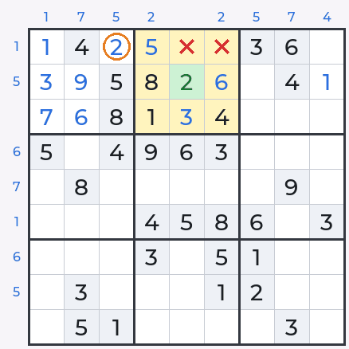

<!-- Written by tools/walkthrough.py numbered-rooms: edit the script, not this page. -->
# Numbered Rooms, step 11: the 2 in box 2

**Step 11 of 51** · [← Step 10](step-10.md) · [All steps](../numbered-rooms.md#the-whole-puzzle-step-by-step) · [Step 12 →](step-12.md)

Box 2 needs a 2. r1c5 and r1c6: row 1 has one (r1c3). Only **r2c5** is left: **r2c5 = 2**.

**Step 11 of 51** · [← Step 10](step-10.md) · [All steps](../numbered-rooms.md#the-whole-puzzle-step-by-step) · [Step 12 →](step-12.md)
