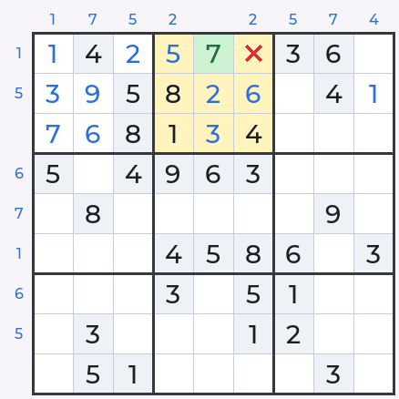

<!-- Written by tools/walkthrough.py numbered-rooms: edit the script, not this page. -->
# Numbered Rooms, step 12: the 7 in box 2

**Step 12 of 51** · [← Step 11](step-11.md) · [All steps](../numbered-rooms.md#the-whole-puzzle-step-by-step) · [Step 13 →](step-13.md)

Box 2 needs a 7. r1c6: with a 7 first, the seventh cell of column 6 would have to hold its clue 2, but it's 5. Only **r1c5** is left: **r1c5 = 7**.

**Step 12 of 51** · [← Step 11](step-11.md) · [All steps](../numbered-rooms.md#the-whole-puzzle-step-by-step) · [Step 13 →](step-13.md)
