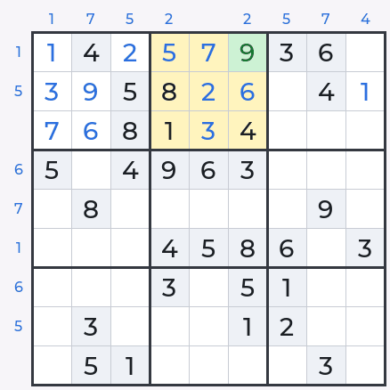

<!-- Written by tools/walkthrough.py numbered-rooms: edit the script, not this page. -->
# Numbered Rooms, step 13: the 9 in box 2

**Step 13 of 51** · [← Step 12](step-12.md) · [All steps](../numbered-rooms.md#the-whole-puzzle-step-by-step) · [Step 14 →](step-14.md)

Box 2 needs a 9, and r1c6 is its last empty cell: **r1c6 = 9**.

**Step 13 of 51** · [← Step 12](step-12.md) · [All steps](../numbered-rooms.md#the-whole-puzzle-step-by-step) · [Step 14 →](step-14.md)
