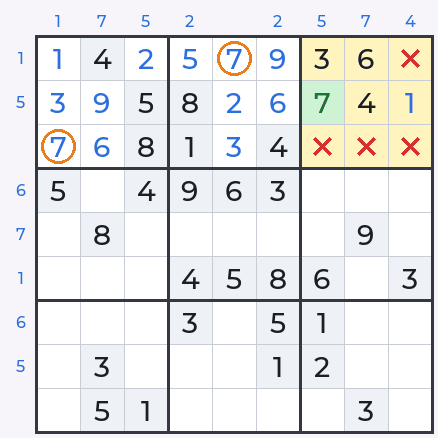

<!-- Written by tools/walkthrough.py numbered-rooms: edit the script, not this page. -->
# Numbered Rooms, step 14: the 7 in box 3

**Step 14 of 51** · [← Step 13](step-13.md) · [All steps](../numbered-rooms.md#the-whole-puzzle-step-by-step) · [Step 15 →](step-15.md)

Box 3 needs a 7. r1c9: row 1 has one (r1c5). r3c7, r3c8 and r3c9: row 3 has one (r3c1). Only **r2c7** is left: **r2c7 = 7**.

**Step 14 of 51** · [← Step 13](step-13.md) · [All steps](../numbered-rooms.md#the-whole-puzzle-step-by-step) · [Step 15 →](step-15.md)
