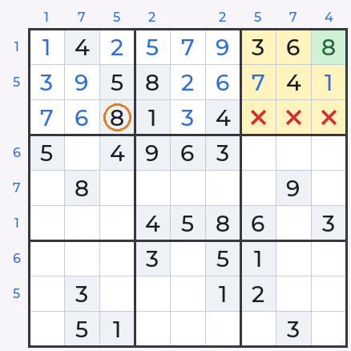

<!-- Written by tools/walkthrough.py numbered-rooms: edit the script, not this page. -->
# Numbered Rooms, step 15: the 8 in box 3

**Step 15 of 51** · [← Step 14](step-14.md) · [All steps](../numbered-rooms.md#the-whole-puzzle-step-by-step) · [Step 16 →](step-16.md)

Box 3 needs an 8. r3c7, r3c8 and r3c9: row 3 has one (r3c3). Only **r1c9** is left: **r1c9 = 8**.

**Step 15 of 51** · [← Step 14](step-14.md) · [All steps](../numbered-rooms.md#the-whole-puzzle-step-by-step) · [Step 16 →](step-16.md)
