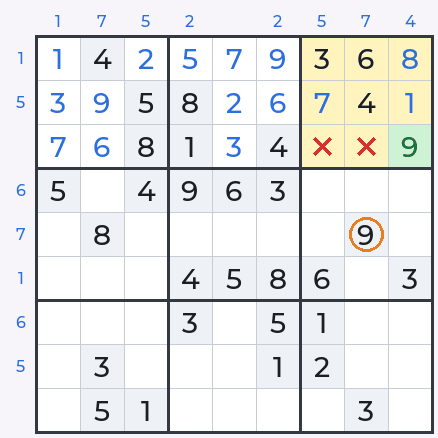

<!-- Written by tools/walkthrough.py numbered-rooms: edit the script, not this page. -->
# Numbered Rooms, step 16: the 9 in box 3

**Step 16 of 51** · [← Step 15](step-15.md) · [All steps](../numbered-rooms.md#the-whole-puzzle-step-by-step) · [Step 17 →](step-17.md)

Box 3 needs a 9. r3c8: column 8 has one (r5c8). r3c7: Column 7 starts with a 3, so its third cell is its clue 5. Only **r3c9** is left: **r3c9 = 9**.

**Step 16 of 51** · [← Step 15](step-15.md) · [All steps](../numbered-rooms.md#the-whole-puzzle-step-by-step) · [Step 17 →](step-17.md)
