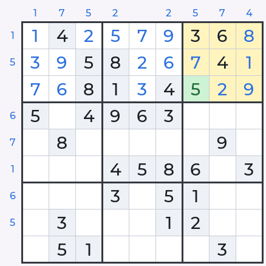

<!-- Written by tools/walkthrough.py numbered-rooms: edit the script, not this page. -->
# Numbered Rooms, step 18: the 5 in box 3

**Step 18 of 51** · [← Step 17](step-17.md) · [All steps](../numbered-rooms.md#the-whole-puzzle-step-by-step) · [Step 19 →](step-19.md)

Box 3 needs a 5, and r3c7 is its last empty cell: **r3c7 = 5**.

**Step 18 of 51** · [← Step 17](step-17.md) · [All steps](../numbered-rooms.md#the-whole-puzzle-step-by-step) · [Step 19 →](step-19.md)
