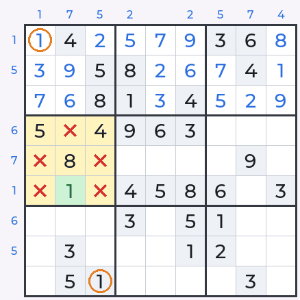

<!-- Written by tools/walkthrough.py numbered-rooms: edit the script, not this page. -->
# Numbered Rooms, step 19: the 1 in box 4

**Step 19 of 51** · [← Step 18](step-18.md) · [All steps](../numbered-rooms.md#the-whole-puzzle-step-by-step) · [Step 20 →](step-20.md)

Box 4 needs a 1. r5c1 and r6c1: column 1 has one (r1c1). r5c3 and r6c3: column 3 has one (r9c3). r4c2: Column 2 starts with a 4, so its fourth cell is its clue 7. Only **r6c2** is left: **r6c2 = 1**.

**Step 19 of 51** · [← Step 18](step-18.md) · [All steps](../numbered-rooms.md#the-whole-puzzle-step-by-step) · [Step 20 →](step-20.md)
