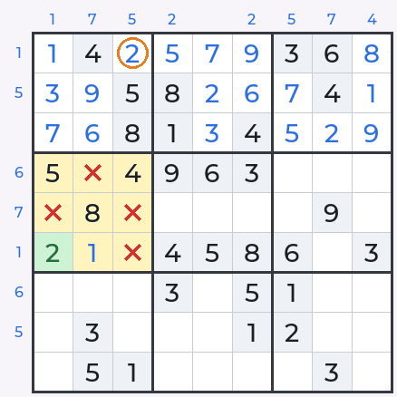

<!-- Written by tools/walkthrough.py numbered-rooms: edit the script, not this page. -->
# Numbered Rooms, step 20: the 2 in box 4

**Step 20 of 51** · [← Step 19](step-19.md) · [All steps](../numbered-rooms.md#the-whole-puzzle-step-by-step) · [Step 21 →](step-21.md)

Box 4 needs a 2. r5c3 and r6c3: column 3 has one (r1c3). r4c2: Column 2 starts with a 4, so its fourth cell is its clue 7. r5c1: with a 2 first, the second cell of row 5 would have to hold its clue 7, but it's 8. Only **r6c1** is left: **r6c1 = 2**.

**Step 20 of 51** · [← Step 19](step-19.md) · [All steps](../numbered-rooms.md#the-whole-puzzle-step-by-step) · [Step 21 →](step-21.md)
