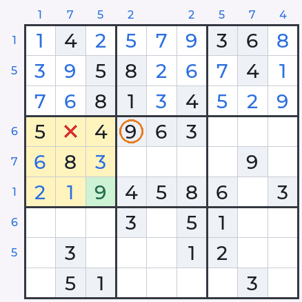

<!-- Written by tools/walkthrough.py numbered-rooms: edit the script, not this page. -->
# Numbered Rooms, step 23: the 9 in box 4

**Step 23 of 51** · [← Step 22](step-22.md) · [All steps](../numbered-rooms.md#the-whole-puzzle-step-by-step) · [Step 24 →](step-24.md)

Box 4 needs a 9. r4c2: row 4 has one (r4c4). Only **r6c3** is left: **r6c3 = 9**.

**Step 23 of 51** · [← Step 22](step-22.md) · [All steps](../numbered-rooms.md#the-whole-puzzle-step-by-step) · [Step 24 →](step-24.md)
