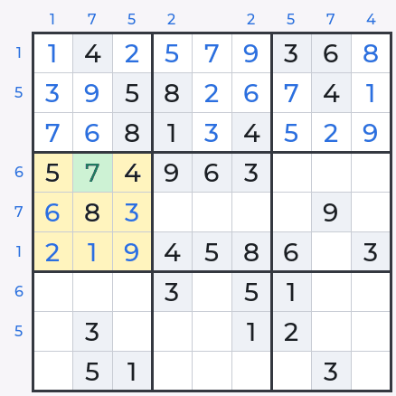

<!-- Written by tools/walkthrough.py numbered-rooms: edit the script, not this page. -->
# Numbered Rooms, step 24: the 7 in box 4

**Step 24 of 51** · [← Step 23](step-23.md) · [All steps](../numbered-rooms.md#the-whole-puzzle-step-by-step) · [Step 25 →](step-25.md)

Box 4 needs a 7, and r4c2 is its last empty cell: **r4c2 = 7**.

**Step 24 of 51** · [← Step 23](step-23.md) · [All steps](../numbered-rooms.md#the-whole-puzzle-step-by-step) · [Step 25 →](step-25.md)
