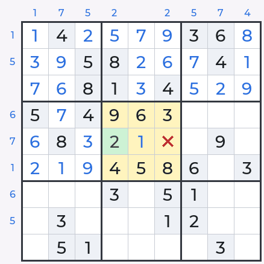

<!-- Written by tools/walkthrough.py numbered-rooms: edit the script, not this page. -->
# Numbered Rooms, step 26: the 2 in box 5

**Step 26 of 51** · [← Step 25](step-25.md) · [All steps](../numbered-rooms.md#the-whole-puzzle-step-by-step) · [Step 27 →](step-27.md)

Box 5 needs a 2. r5c6: Row 5 starts with a 6, so its sixth cell is its clue 7. Only **r5c4** is left: **r5c4 = 2**.

**Step 26 of 51** · [← Step 25](step-25.md) · [All steps](../numbered-rooms.md#the-whole-puzzle-step-by-step) · [Step 27 →](step-27.md)
