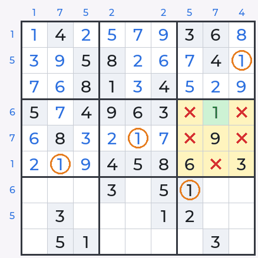

<!-- Written by tools/walkthrough.py numbered-rooms: edit the script, not this page. -->
# Numbered Rooms, step 28: the 1 in box 6

**Step 28 of 51** · [← Step 27](step-27.md) · [All steps](../numbered-rooms.md#the-whole-puzzle-step-by-step) · [Step 29 →](step-29.md)

Box 6 needs a 1. r4c7: column 7 has one (r7c7). r4c9: column 9 has one (r2c9). r5c7 and r5c9: row 5 has one (r5c5). r6c8: row 6 has one (r6c2). Only **r4c8** is left: **r4c8 = 1**.

**Step 28 of 51** · [← Step 27](step-27.md) · [All steps](../numbered-rooms.md#the-whole-puzzle-step-by-step) · [Step 29 →](step-29.md)
