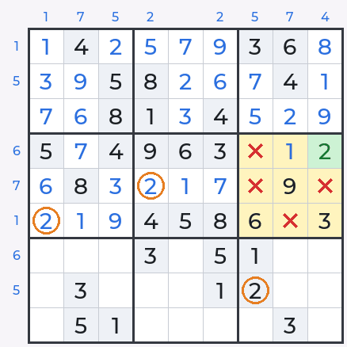

<!-- Written by tools/walkthrough.py numbered-rooms: edit the script, not this page. -->
# Numbered Rooms, step 29: the 2 in box 6

**Step 29 of 51** · [← Step 28](step-28.md) · [All steps](../numbered-rooms.md#the-whole-puzzle-step-by-step) · [Step 30 →](step-30.md)

Box 6 needs a 2. r4c7: column 7 has one (r8c7). r5c7 and r5c9: row 5 has one (r5c4). r6c8: row 6 has one (r6c1). Only **r4c9** is left: **r4c9 = 2**.

**Step 29 of 51** · [← Step 28](step-28.md) · [All steps](../numbered-rooms.md#the-whole-puzzle-step-by-step) · [Step 30 →](step-30.md)
