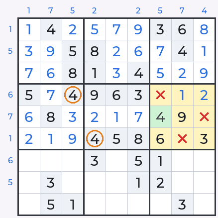

<!-- Written by tools/walkthrough.py numbered-rooms: edit the script, not this page. -->
# Numbered Rooms, step 30: the 4 in box 6

**Step 30 of 51** · [← Step 29](step-29.md) · [All steps](../numbered-rooms.md#the-whole-puzzle-step-by-step) · [Step 31 →](step-31.md)

Box 6 needs a 4. r4c7: row 4 has one (r4c3). r6c8: row 6 has one (r6c4). r5c9: Column 9 starts with an 8, so its clue 4 is in its eighth cell, not here. Only **r5c7** is left: **r5c7 = 4**.

**Step 30 of 51** · [← Step 29](step-29.md) · [All steps](../numbered-rooms.md#the-whole-puzzle-step-by-step) · [Step 31 →](step-31.md)
