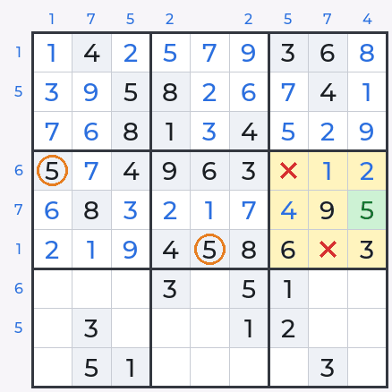

<!-- Written by tools/walkthrough.py numbered-rooms: edit the script, not this page. -->
# Numbered Rooms, step 31: the 5 in box 6

**Step 31 of 51** · [← Step 30](step-30.md) · [All steps](../numbered-rooms.md#the-whole-puzzle-step-by-step) · [Step 32 →](step-32.md)

Box 6 needs a 5. r4c7: row 4 has one (r4c1). r6c8: row 6 has one (r6c5). Only **r5c9** is left: **r5c9 = 5**.

**Step 31 of 51** · [← Step 30](step-30.md) · [All steps](../numbered-rooms.md#the-whole-puzzle-step-by-step) · [Step 32 →](step-32.md)
