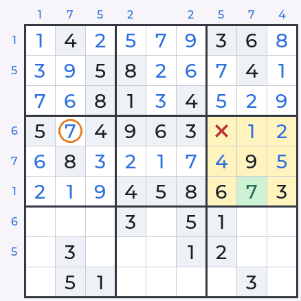

<!-- Written by tools/walkthrough.py numbered-rooms: edit the script, not this page. -->
# Numbered Rooms, step 32: the 7 in box 6

**Step 32 of 51** · [← Step 31](step-31.md) · [All steps](../numbered-rooms.md#the-whole-puzzle-step-by-step) · [Step 33 →](step-33.md)

Box 6 needs a 7. r4c7: row 4 has one (r4c2). Only **r6c8** is left: **r6c8 = 7**.

**Step 32 of 51** · [← Step 31](step-31.md) · [All steps](../numbered-rooms.md#the-whole-puzzle-step-by-step) · [Step 33 →](step-33.md)
