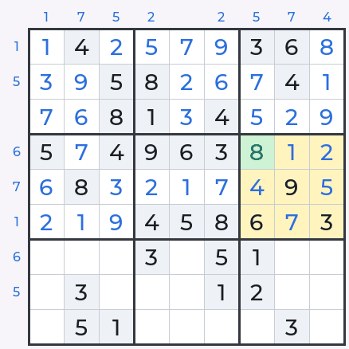

<!-- Written by tools/walkthrough.py numbered-rooms: edit the script, not this page. -->
# Numbered Rooms, step 33: the 8 in box 6

**Step 33 of 51** · [← Step 32](step-32.md) · [All steps](../numbered-rooms.md#the-whole-puzzle-step-by-step) · [Step 34 →](step-34.md)

Box 6 needs an 8, and r4c7 is its last empty cell: **r4c7 = 8**.

**Step 33 of 51** · [← Step 32](step-32.md) · [All steps](../numbered-rooms.md#the-whole-puzzle-step-by-step) · [Step 34 →](step-34.md)
