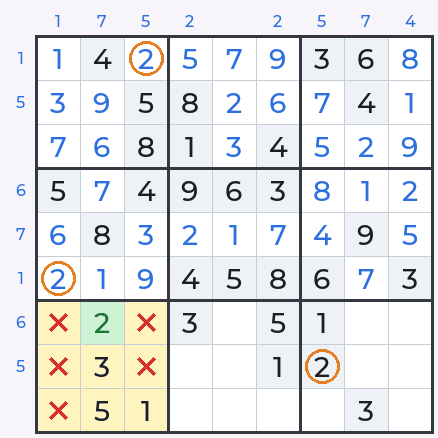

<!-- Written by tools/walkthrough.py numbered-rooms: edit the script, not this page. -->
# Numbered Rooms, step 34: the 2 in box 7

**Step 34 of 51** · [← Step 33](step-33.md) · [All steps](../numbered-rooms.md#the-whole-puzzle-step-by-step) · [Step 35 →](step-35.md)

Box 7 needs a 2. r7c1 and r9c1: column 1 has one (r6c1). r7c3: column 3 has one (r1c3). r8c1 and r8c3: row 8 has one (r8c7). Only **r7c2** is left: **r7c2 = 2**.

**Step 34 of 51** · [← Step 33](step-33.md) · [All steps](../numbered-rooms.md#the-whole-puzzle-step-by-step) · [Step 35 →](step-35.md)
