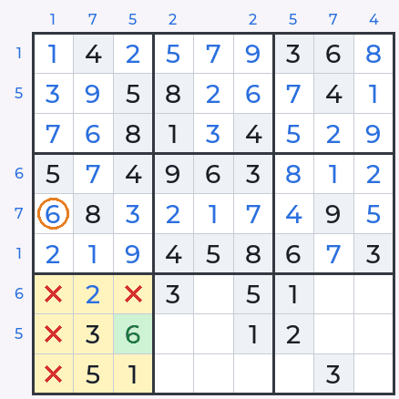

<!-- Written by tools/walkthrough.py numbered-rooms: edit the script, not this page. -->
# Numbered Rooms, step 35: the 6 in box 7

**Step 35 of 51** · [← Step 34](step-34.md) · [All steps](../numbered-rooms.md#the-whole-puzzle-step-by-step) · [Step 36 →](step-36.md)

Box 7 needs a 6. r7c1, r8c1 and r9c1: column 1 has one (r5c1). r7c3: with a 6 here, no first digit of row 7 could point at a cell holding its clue 6. Only **r8c3** is left: **r8c3 = 6**.

**Step 35 of 51** · [← Step 34](step-34.md) · [All steps](../numbered-rooms.md#the-whole-puzzle-step-by-step) · [Step 36 →](step-36.md)
