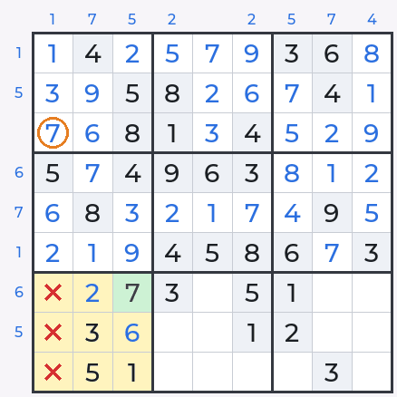

<!-- Written by tools/walkthrough.py numbered-rooms: edit the script, not this page. -->
# Numbered Rooms, step 36: the 7 in box 7

**Step 36 of 51** · [← Step 35](step-35.md) · [All steps](../numbered-rooms.md#the-whole-puzzle-step-by-step) · [Step 37 →](step-37.md)

Box 7 needs a 7. r7c1, r8c1 and r9c1: column 1 has one (r3c1). Only **r7c3** is left: **r7c3 = 7**.

**Step 36 of 51** · [← Step 35](step-35.md) · [All steps](../numbered-rooms.md#the-whole-puzzle-step-by-step) · [Step 37 →](step-37.md)
