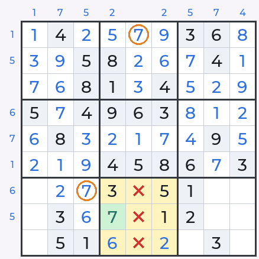

<!-- Written by tools/walkthrough.py numbered-rooms: edit the script, not this page. -->
# Numbered Rooms, step 39: the 7 in box 8

**Step 39 of 51** · [← Step 38](step-38.md) · [All steps](../numbered-rooms.md#the-whole-puzzle-step-by-step) · [Step 40 →](step-40.md)

Box 8 needs a 7. r7c5: row 7 has one (r7c3). r8c5 and r9c5: column 5 has one (r1c5). Only **r8c4** is left: **r8c4 = 7**.

**Step 39 of 51** · [← Step 38](step-38.md) · [All steps](../numbered-rooms.md#the-whole-puzzle-step-by-step) · [Step 40 →](step-40.md)
