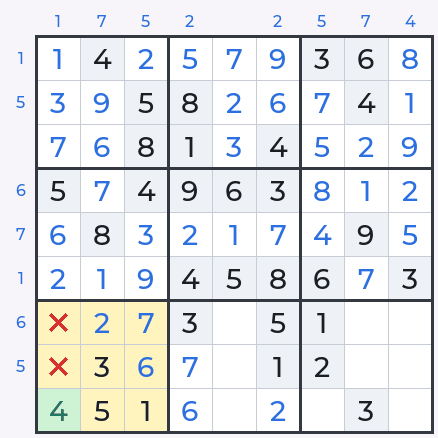

<!-- Written by tools/walkthrough.py numbered-rooms: edit the script, not this page. -->
# Numbered Rooms, step 40: the 4 in box 7

**Step 40 of 51** · [← Step 39](step-39.md) · [All steps](../numbered-rooms.md#the-whole-puzzle-step-by-step) · [Step 41 →](step-41.md)

Box 7 needs a 4. r7c1: with a 4 first, the fourth cell of row 7 would have to hold its clue 6, but it's 3. r8c1: with a 4 first, the fourth cell of row 8 would have to hold its clue 5, but it's 7. Only **r9c1** is left: **r9c1 = 4**.

**Step 40 of 51** · [← Step 39](step-39.md) · [All steps](../numbered-rooms.md#the-whole-puzzle-step-by-step) · [Step 41 →](step-41.md)
