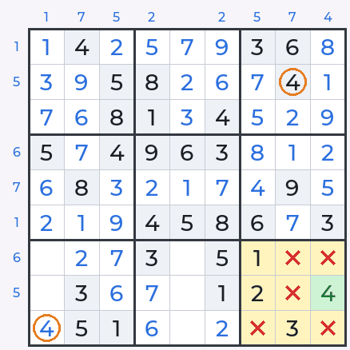

<!-- Written by tools/walkthrough.py numbered-rooms: edit the script, not this page. -->
# Numbered Rooms, step 41: the 4 in box 9

**Step 41 of 51** · [← Step 40](step-40.md) · [All steps](../numbered-rooms.md#the-whole-puzzle-step-by-step) · [Step 42 →](step-42.md)

Box 9 needs a 4. r7c8 and r8c8: column 8 has one (r2c8). r9c7 and r9c9: row 9 has one (r9c1). r7c9: Column 9 starts with an 8, so its clue 4 is in its eighth cell, not here. Only **r8c9** is left: **r8c9 = 4**.

**Step 41 of 51** · [← Step 40](step-40.md) · [All steps](../numbered-rooms.md#the-whole-puzzle-step-by-step) · [Step 42 →](step-42.md)
