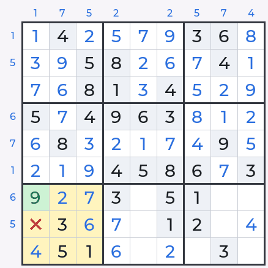

<!-- Written by tools/walkthrough.py numbered-rooms: edit the script, not this page. -->
# Numbered Rooms, step 42: the 9 in box 7

**Step 42 of 51** · [← Step 41](step-41.md) · [All steps](../numbered-rooms.md#the-whole-puzzle-step-by-step) · [Step 43 →](step-43.md)

Box 7 needs a 9. r8c1: with a 9 first, the ninth cell of row 8 would have to hold its clue 5, but it's 4. Only **r7c1** is left: **r7c1 = 9**.

**Step 42 of 51** · [← Step 41](step-41.md) · [All steps](../numbered-rooms.md#the-whole-puzzle-step-by-step) · [Step 43 →](step-43.md)
