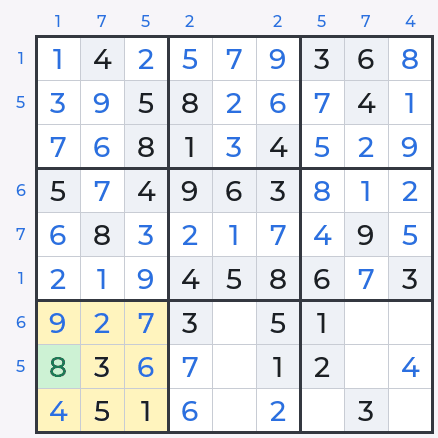

<!-- Written by tools/walkthrough.py numbered-rooms: edit the script, not this page. -->
# Numbered Rooms, step 43: the 8 in box 7

**Step 43 of 51** · [← Step 42](step-42.md) · [All steps](../numbered-rooms.md#the-whole-puzzle-step-by-step) · [Step 44 →](step-44.md)

Box 7 needs an 8, and r8c1 is its last empty cell: **r8c1 = 8**.

**Step 43 of 51** · [← Step 42](step-42.md) · [All steps](../numbered-rooms.md#the-whole-puzzle-step-by-step) · [Step 44 →](step-44.md)
