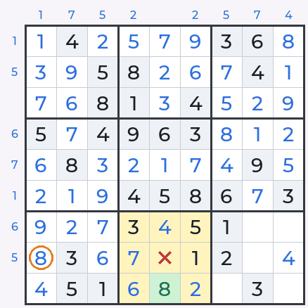

<!-- Written by tools/walkthrough.py numbered-rooms: edit the script, not this page. -->
# Numbered Rooms, step 45: the 8 in box 8

**Step 45 of 51** · [← Step 44](step-44.md) · [All steps](../numbered-rooms.md#the-whole-puzzle-step-by-step) · [Step 46 →](step-46.md)

Box 8 needs an 8. r8c5: row 8 has one (r8c1). Only **r9c5** is left: **r9c5 = 8**.

**Step 45 of 51** · [← Step 44](step-44.md) · [All steps](../numbered-rooms.md#the-whole-puzzle-step-by-step) · [Step 46 →](step-46.md)
