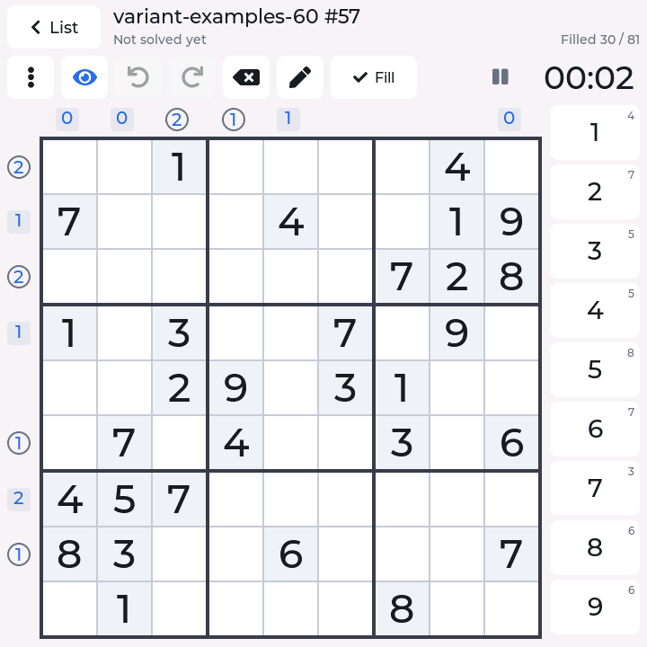

# Odd/Even Skyscrapers

[← All variants](README.md) · [Puzzles](../features-puzzles.md) · [How to play](../how-to-play.md)

## The rules

[Classic](classic.md) rules, and clues outside the grid, as in [Skyscraper](skyscraper.md): each digit is a building that tall, and looking from a clue along its row or column, a taller building hides every shorter one behind it. But a clue counts only buildings of **one parity**:

- a **ringed** clue counts the **odd** buildings seen;
- a **shaded** clue counts the **even** ones.

In 2 5 1 9 8 the buildings seen are 2, 5 and 9: a ringed clue there is 2 (5 and 9), a shaded one 1 (the 2). The 9 is always seen, so a ringed clue is 1 at least; a shaded one can be 0.

## On the board

- The clues are in the margins left of the rows and above the columns: ringed for odd, shaded for even (like Even-Odd's cells).
- The cells from the clue up to the first empty one (or the 9) turn red when they already show more buildings of that parity than the clue, or, the 9 reached, a different count.
- The grader and hints try every order of a line's last few missing digits: "From the clue of row 6, 1 odd building is seen: of the ways its empty cells can be filled, only those leave row 6, column 1 9."
- **Puzzles → ⋮ → New puzzle → Clues → Odd/Even Sky**: about three quarters of the lines have a clue (Hard and Expert: about 60 %).

## How to solve it

- **A ringed 1:** only the 9 is the odd one seen, so every odd digit before the 9 is hidden by a taller even one, or the line starts with the 9.
- **A shaded 0:** no even building is seen, so the line starts with an odd digit taller than every even one before the 9 (often the 9 itself, or a 7 with only small evens before it).
- **Big counts need rising lines:** a ringed 5 is 1, 3, 5, 7, 9 seen in order; a shaded 4 is 2, 4, 6, 8 before the 9.

## Worked example

**variant-examples #57**, Odd/Even Skyscrapers Easy (see [Classic](classic.md#worked-example-the-whole-puzzle) for how to import the examples; cells are written r*row*c*column*). From the left, row 6's clue is a ringed **1**; from the top, column 2's is a shaded **0**.

**Step 1: r6c1, row 6 (ringed 1).** Row 6 has 7, 4, 3 and 6; column 1 has 1 and 8; box 4 has 2: that leaves 5 and 9. A 5 first would be seen, and so would the 7 after it in r6c2: two odd buildings, not 1. **r6c1 = 9** (only the 9 is seen).

**A later step: the 2 in column 2 (shaded 0).** r1c2 is the first cell of column 2: a 2 there would be an even building seen, and the clue says none. The other cells see a 2 in their row or box, or are filled. **r2c2 = 2**.

## The whole puzzle, step by step

<!-- walkthrough -->
<!-- Written by tools/walkthrough.py odd-even-skyscrapers: edit the script, not this part. -->

The whole puzzle, from the start to the last cell: 51 steps, each one a single (one place left for a digit, or one digit left for a cell), taken in the order a box's single comes first, so not quite the order of the worked example above. Each step has a page of its own, with **Previous** and **Next**: pick one from the list below. In each picture, the unit the step looks at is tinted yellow (for a cell with one digit left: its row, column and box), the new digit is on green, the digits that rule cells out have an **orange ring**, and the empty cells they rule out a **red cross**. Givens are on grey, digits from earlier steps in blue.

1. [the 2 in box 1](odd-even-skyscrapers/step-01.md)
2. [the 8 in box 1](odd-even-skyscrapers/step-02.md)
3. [the 7 in box 2](odd-even-skyscrapers/step-03.md)
4. [the 3 in box 3](odd-even-skyscrapers/step-04.md)
5. [the 3 in box 1](odd-even-skyscrapers/step-05.md)
6. [the 3 in box 2](odd-even-skyscrapers/step-06.md)
7. [the 2 in box 2](odd-even-skyscrapers/step-07.md)
8. [the 8 in box 2](odd-even-skyscrapers/step-08.md)
9. [the 9 in box 2](odd-even-skyscrapers/step-09.md)
10. [the 9 in box 1](odd-even-skyscrapers/step-10.md)
11. [the 6 in box 5](odd-even-skyscrapers/step-11.md)
12. [the 6 in box 2](odd-even-skyscrapers/step-12.md)
13. [the 6 in box 3](odd-even-skyscrapers/step-13.md)
14. [the 5 in box 3](odd-even-skyscrapers/step-14.md)
15. [the 4 in box 4](odd-even-skyscrapers/step-15.md)
16. [the 4 in box 1](odd-even-skyscrapers/step-16.md)
17. [the 5 in box 1](odd-even-skyscrapers/step-17.md)
18. [the 6 in box 1](odd-even-skyscrapers/step-18.md)
19. [the 5 in box 4](odd-even-skyscrapers/step-19.md)
20. [the 6 in box 4](odd-even-skyscrapers/step-20.md)
21. [the 8 in box 4](odd-even-skyscrapers/step-21.md)
22. [the 9 in box 4](odd-even-skyscrapers/step-22.md)
23. [the 7 in box 6](odd-even-skyscrapers/step-23.md)
24. [the 8 in box 6](odd-even-skyscrapers/step-24.md)
25. [the 8 in box 5](odd-even-skyscrapers/step-25.md)
26. [the 5 in box 5](odd-even-skyscrapers/step-26.md)
27. [the 5 in box 2](odd-even-skyscrapers/step-27.md)
28. [the 1 in box 2](odd-even-skyscrapers/step-28.md)
29. [the 1 in box 5](odd-even-skyscrapers/step-29.md)
30. [the 2 in box 5](odd-even-skyscrapers/step-30.md)
31. [the 5 in box 6](odd-even-skyscrapers/step-31.md)
32. [the 2 in box 7](odd-even-skyscrapers/step-32.md)
33. [the 6 in box 7](odd-even-skyscrapers/step-33.md)
34. [the 9 in box 7](odd-even-skyscrapers/step-34.md)
35. [the 7 in box 8](odd-even-skyscrapers/step-35.md)
36. [the 8 in box 8](odd-even-skyscrapers/step-36.md)
37. [the 1 in box 9](odd-even-skyscrapers/step-37.md)
38. [the 1 in box 8](odd-even-skyscrapers/step-38.md)
39. [the 2 in box 8](odd-even-skyscrapers/step-39.md)
40. [the 9 in box 8](odd-even-skyscrapers/step-40.md)
41. [the 3 in box 8](odd-even-skyscrapers/step-41.md)
42. [the 2 in box 9](odd-even-skyscrapers/step-42.md)
43. [the 2 in box 6](odd-even-skyscrapers/step-43.md)
44. [the 4 in box 6](odd-even-skyscrapers/step-44.md)
45. [the 3 in box 9](odd-even-skyscrapers/step-45.md)
46. [the 4 in box 9](odd-even-skyscrapers/step-46.md)
47. [the 4 in box 8](odd-even-skyscrapers/step-47.md)
48. [the 5 in box 8](odd-even-skyscrapers/step-48.md)
49. [the 5 in box 9](odd-even-skyscrapers/step-49.md)
50. [the 6 in box 9](odd-even-skyscrapers/step-50.md)
51. [the 9 in box 9](odd-even-skyscrapers/step-51.md)

Solved.

<!-- /walkthrough -->
